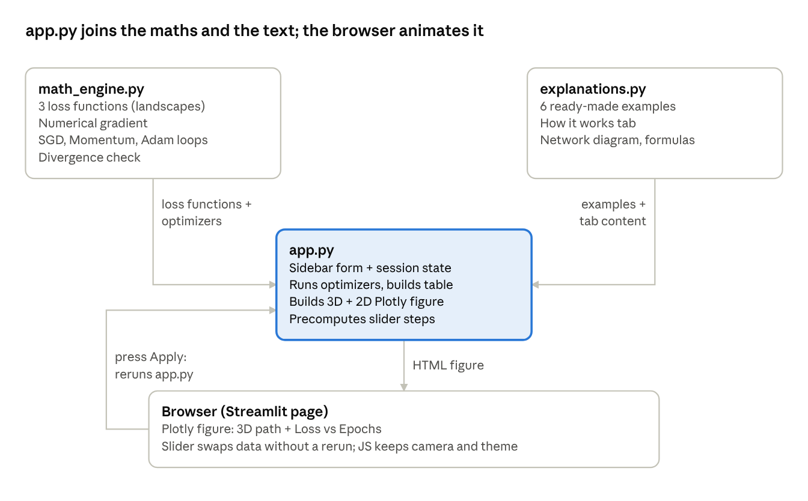

# 3D Gradient Descent Visualizer

An interactive web app that shows how a neural network learns by **gradient descent**. You pick a 3D loss landscape and a starting point for two weights `(w1, w2)`, and the app animates step by step how different optimizers move downhill towards a minimum.



## Features

- **3 loss landscapes:** non-convex surface (multiple valleys), Rosenbrock (narrow curved valley) and convex bowl (single minimum).
- **3 optimizers compared on the same graph:** SGD, Momentum and Adam, each with its own hyperparameters (learning rate, beta values).
- **Controls** for the starting position and the number of iterations, plus ready-made examples that show typical optimizer behaviour (for example divergence or getting stuck in a local minimum).
- **"How it works" tab** that explains the concepts behind the visualizer.

Built with Python, NumPy, Plotly and Streamlit.

## Project structure

```
artifact1Build/
  app.py            Streamlit interface and 3D plots
  math_engine.py    Loss functions, gradients and optimizers (SGD, Momentum, Adam)
  explanations.py   Examples and the "How it works" tab
  requirements.txt  Dependencies
sprint1_docs/       Plan, notes, feedback and retrospectives from the project
images/             Diagram of the program structure
```

## How to run it

You need Python 3.10 or newer.

```bash
cd artifact1Build
python -m venv .venv
```

Activate the virtual environment:

- Windows (PowerShell): `.\.venv\Scripts\Activate.ps1`
- macOS / Linux: `source .venv/bin/activate`

Install the dependencies and start the app:

```bash
pip install -r requirements.txt
streamlit run app.py
```

The app opens in your browser at http://localhost:8501. The first time you run it, Streamlit may ask for an email address in the terminal; press Enter to skip it. Press `Ctrl+C` in the terminal to stop the app.
