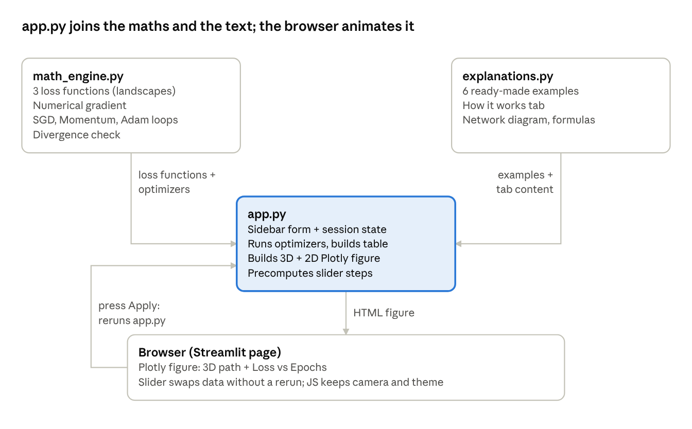

# Gradient Visualizer — Presentation Prep

Nov 1, 2026 · Marcos

## What the artifact is

I built a 3D Gradient Descent Visualizer: a small web app where you can watch, step by step, how an optimizer moves the weights of a neural network downhill. It's based on chapters 1, 2, 4 and 5 of *Deep Learning with Python*, and I made it with Python, NumPy, Plotly and Streamlit.

The idea I want people to remember: a real network has millions of weights, so you can never draw its loss. So I took the smallest network possible, with only two weights (w1 and w2). Now every pair of weights is a point on a map, and the loss is the height at that point.

What I can do with it:

- choose one of three landscapes, a starting point, the number of epochs and the hyperparameters
- put SGD, Momentum and Adam on the same surface, all starting from the same point
- move the step slider and see the 3D path and the loss curve move together
- load one of the six examples, each one shows a typical behaviour of the optimizers

## The parts of the program

The code is split into three files in `artifact1Build/`. I kept the maths, the explanation text and the app apart, so I can change one without breaking the others.



- `math_engine.py` is only maths, it doesn't know anything about Streamlit. Every optimizer gives back the same thing: the path, a list of w1, w2 and loss for every step.
- `app.py` glues everything together. It takes those paths and turns them into the table and the graphs.
- `explanations.py` is only text: the examples and the How it works tab.

Once the graph is in the browser, the slider works there on its own. Python isn't involved anymore, that's why it moves so smoothly.

## How it works

When you press **Apply**, Streamlit runs `app.py` again from top to bottom. What happens, in order:

1. **It reads the settings.** All the sliders are inside a form, so moving them does nothing until you press Apply. That was feedback from the review sessions: the graph kept changing by accident. Reset and the examples just overwrite the saved values.
2. **It runs the optimizers.** Each selected optimizer gets the same landscape, the same starting point and the same number of steps, so the comparison is fair. Each one gives back its path.
3. **It calculates the gradient at every step.** I don't write the derivative by hand. I move each weight a tiny bit up and down and look at how much the loss changes (central finite difference). That way it works for any landscape I add.
4. **It checks if it exploded.** If a value becomes infinite or NaN, or a weight goes further than 10, the loop stops and the app shows a red warning that the learning rate is too high.
5. **It fills the comparison table.** Final weights, final loss, lowest loss, and the step where it got there.
6. **It draws the surface.** I make a 100 × 100 grid from −2 to 2 with `np.linspace` and `np.meshgrid`, and calculate the loss on the whole grid at once with NumPy.
7. **It builds one figure with two graphs.** On the left the 3D path on the landscape, on the right the loss per epoch. Both are in the same figure so one slider can move them together.
8. **It prepares every slider step in advance.** For each step I save the path up to that point. Moving the slider only swaps that data in the browser, no rerun.
9. **It adds a bit of JavaScript.** The camera keeps its angle when the slider moves, the mouse wheel scrolls the page instead of zooming the graph away, and the colours follow light or dark mode.

### Gradient vs backpropagation

The gradient is just the slope in each direction: how much the loss changes if I change w1 a little, and the same for w2. In my app I measure it with this formula, with ε = 0.00001:

```math
\frac{\partial L}{\partial w_1} \approx \frac{L(w_1+\epsilon,\,w_2) - L(w_1-\epsilon,\,w_2)}{2\epsilon}
```

In a real network this is done with **backpropagation**. The network is a chain of layers, so the loss depends on the output, the output depends on the last layer, and so on back to the first weights. Backpropagation uses the **chain rule** to go backwards through that chain once and get the exact derivative for every weight at the same time.

Why I didn't use it: with my finite difference I need 2 loss calculations per weight. With 2 weights that's 4, nothing. With millions of weights it would be millions of passes per step, so real networks need backprop. Both give the same gradient, and what the optimizer does with it is exactly the same.

### The three optimizers

| Optimizer | Update | How I explain it |
| --- | --- | --- |
| SGD | w ← w − η ∇L | Only looks at the slope where it is standing. Slow on flat parts. |
| Momentum | v ← βv − η ∇L, then w ← w + v | A ball rolling downhill that keeps its speed (β = 0.9). Faster, but it can roll past the minimum. |
| Adam | w ← w − η m̂ / (√v̂ + ε) | Momentum plus its own step size for each weight. Every step is about η long, whatever the slope, so it needs a smaller η. |

### The three landscapes

| Landscape | Formula | Minimum | Why I added it |
| --- | --- | --- | --- |
| Non-convex | 0.2 × (2 peaks − 2 valleys of Gaussian bells) + 0.2 | (1, 1) and (−1, −1) | The starting point decides the valley; saddle point at (0, 0) |
| Rosenbrock | 0.02 × \[(1 − w1)² + 5(w2 − w1²)²\] | (1, 1) | Narrow curved valley with a flat floor, the classic optimizer test |
| Convex bowl | 0.15 × (w1² + w2²) | (0, 0) | The easiest case, good to show the effect of the learning rate |

I shifted the non-convex surface up by 0.2 because a real loss is never negative. Adding a constant doesn't change the slope, so the paths stay exactly the same. For the same reason I removed my old saddle landscape: it had no bottom, the loss went down forever.

Why SGD explodes on the bowl: the gradient is 0.3w, so one step gives w\_new = (1 − 0.3η) w. If η is bigger than 6.67, that factor is bigger than 1 in size and every jump is bigger than the last one.

## Examples and the How it works tab

I added the examples because people without experience didn't know what to try (feedback from the review session). One click loads the settings, and a blue box says what to look at. Each example only changes a few settings, the rest go back to the defaults.

| Example | Landscape | Settings | What I point out |
| --- | --- | --- | --- |
| Saddle point trap | Non-convex | start (−1, 1) | All three stop at (0, 0) with loss 0.2. The slope is 0 there, but it's not a minimum. |
| The starting point decides the valley | Non-convex | start (−0.8, 1.2), 60 epochs | They end at (1, 1). If I change the start to (−1.2, 0.8) they end at (−1, −1). That's why initial weights matter. |
| Learning rate too high | Convex bowl | SGD η = 7 | SGD jumps further every step and explodes, and the red warning appears. |
| Learning rate too small | Convex bowl | SGD η = 0.02 | After 40 epochs SGD has barely moved. |
| Momentum overshoots | Convex bowl | η = 0.3, β = 0.95 | It rolls past the minimum and swings back and forth, and its loss curve goes up and down. |
| The Rosenbrock race | Rosenbrock | start (−1, 1), 100 epochs | SGD gets to (0.43, 0.13), Momentum to (0.73, 0.52), Adam to (0.95, 0.90). |

The **How it works** tab is for people without ML background. It explains the same things I explain in this talk: the two axes are the two weights of a tiny network (with a small diagram), the height is the loss, how gradient descent and the learning rate work, the three optimizers and the three landscapes.

## Demo script

About 5 minutes. Before I start: open the app (from `artifact1Build`: `.\.venv\Scripts\python.exe -m streamlit run app.py`, it opens at localhost:8501) and leave the How it works tab open.

1. **The idea (30 s).** I show the network diagram on the How it works tab: two weights, so I can draw the loss as a 3D map. Training just means moving the point downhill.
2. **The default run (1 min).** I go to the Visualizer and point out the start point, the three coloured paths and the comparison table. Then I drag the step slider slowly so they see the 3D path and the loss curve move together.
3. **Learning rate too high (1 min).** I load the example. The SGD path flies off and the red warning appears. I explain the (1 − 0.3η) idea: above η = 6.67 it has to explode.
4. **Saddle point trap (1 min).** I load it. Everything stops at (0, 0) with loss 0.2. The slope is zero, but it's not a valley: gradient descent only knows the slope where it is standing.
5. **The Rosenbrock race (1 min).** I load it. SGD crawls, Momentum speeds up, and Adam gets closest to (1, 1). That's why Adam is the usual default.
6. **Wrap up (30 s).** What I learned: partial derivatives, the update rules, why the learning rate matters so much and how to deal with numerical problems. What I would do next: a JavaScript frontend with nicer visuals and more landscapes.

If the live app fails, I use the screenshots of steps 2 to 5.
